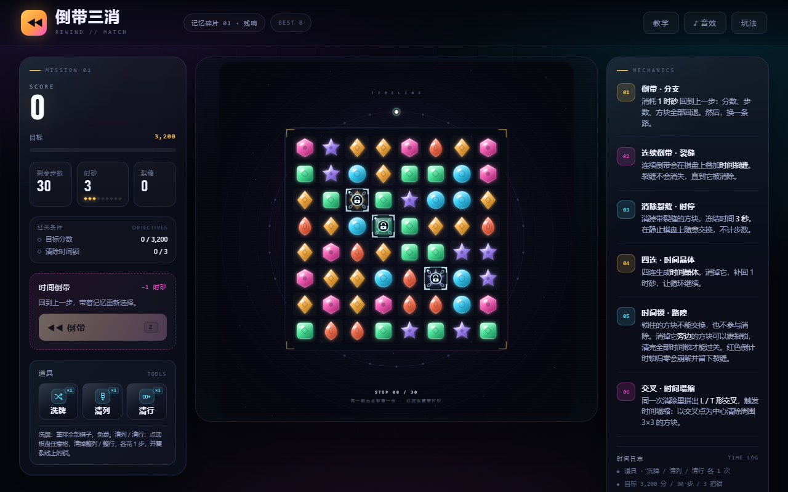
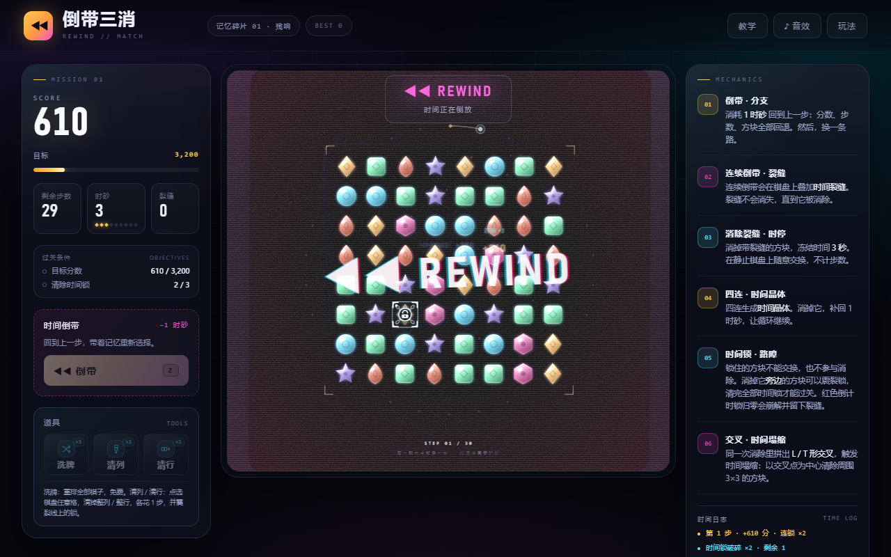
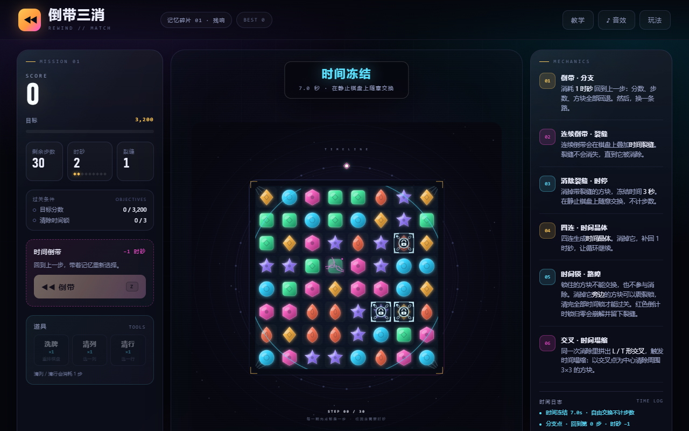
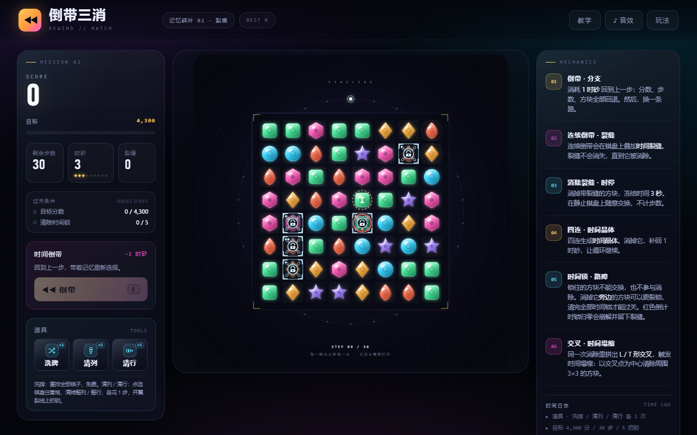
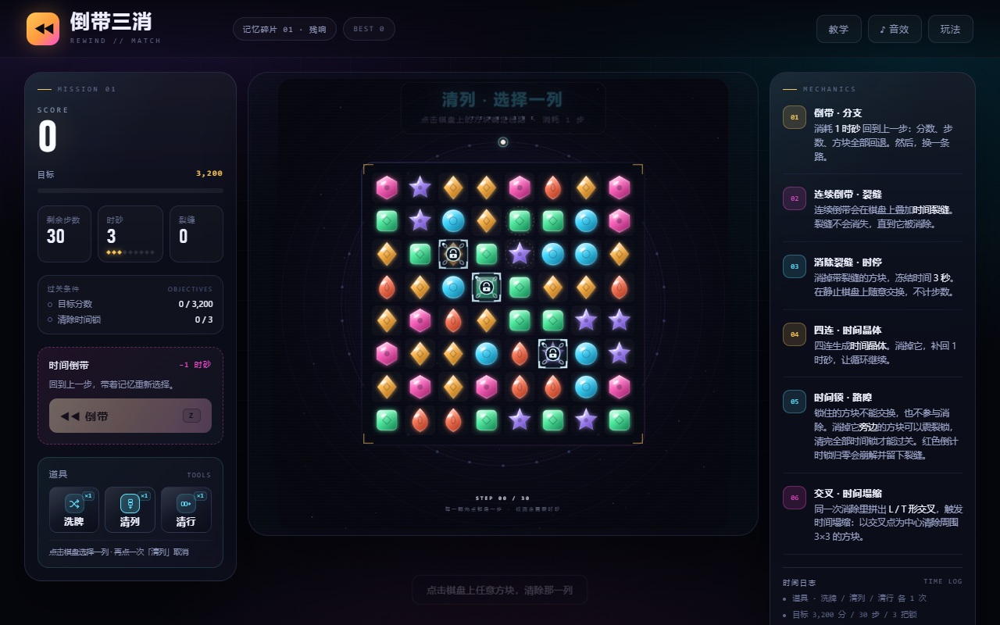
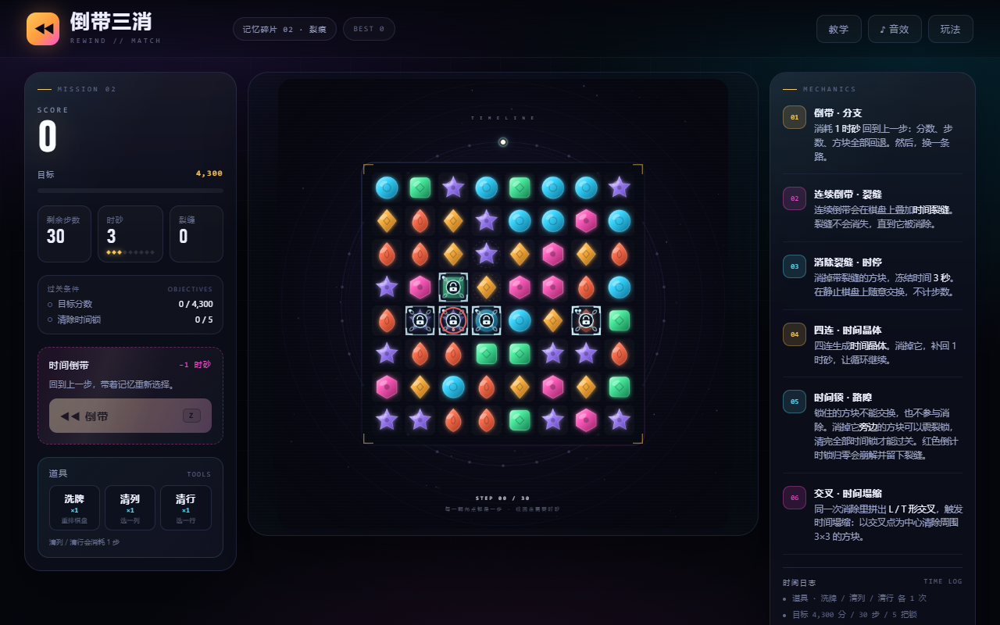

# 倒带三消 · REWIND // MATCH

一款把 **时间回溯做成消耗品** 的三消游戏。

普通三消里，走错一步只能认输；在这里，你可以花 1 枚「时砂」把棋盘、分数、步数一起倒回上一步，然后从同一个节点走另一条分支。倒带会撕开「时间裂缝」，裂缝方块被消除时，时间冻结 3 秒——在静止的棋盘上随意交换，不计步数，最后统一结算。

棋盘上还有会倒计时的「时间锁」；洗牌、清列、清行三种道具；横向和纵向同时成 3 的 L / T 形交叉会触发「时间塌缩」，以交点为中心清掉 3×3。第一次打开会先进教学关「校准」，用 16 步学会交换、倒带和拆锁，再进入正式关卡。

纯前端、零依赖、无需安装。支持桌面与手机浏览器。



## 玩法

| 操作 | 说明 |
| --- | --- |
| 拖动 / 点击两个相邻方块 | 交换，凑齐横向或纵向 3 个同色即可消除 |
| `Z` 或左侧「倒带」按钮 | 花 1 时砂回到上一步：分数、步数、方块位置全部回退 |
| 左侧「洗牌 / 清列 / 清行」 | 每关各 1 次。洗牌免费重排；清列、清行点按钮后再点棋盘，消除整行/整列（1 步，线上的锁受 1 点伤害） |
| 顶栏「教学」 | 随时重玩教学关「校准」 |
| `R` | 重开当前记忆碎片 |
| `H` | 打开玩法说明 |
| `M` | 开关音效 |
| `Esc` | 关闭弹窗 / 取消清列清行选择 |

## 规则

- **过关条件**：在步数耗尽前达到目标分，并且清掉本关全部时间锁；03 · 坍缩还需要收集 1 个时间晶体。
- **步数**：只有“成功交换并至少产生一次消除”才扣 1 步。无效交换会换回、不扣步；时停里的自由交换也不扣步。
- **倒带**：花 1 时砂回到上一步，分数、剩余步数、方块位置全部回退。倒带可以连续用，但第 1 / 2 / 3 次连续倒带会分别叠加 1 / 2 / 3 道裂缝（最多 3 道）。
- **失败**：步数归零且没有完成目标。如果还有时砂和历史记录，结算界面会直接给“倒带重来”。
- **计分**：普通消除每块 30 分 × 连锁倍率；四连生成晶体额外 +100；拆掉一把锁 +80；触发一次 L / T 时间塌缩 +120；时停结束时，棋盘上所有消除一起结算，交换次数越多倍率越高（每 2 次 +1 倍，最高 ×5）。

### 三种道具（每关各 1 次）

| 道具 | 消耗 | 效果 | 使用建议 |
| --- | --- | --- | --- |
| **洗牌** | 不消耗步数 | 把棋盘上剩余方块重新随机排列，分数不变，锁和裂缝的数量也不变 | 没有可消步、或锁被卡住时用来换局面 |
| **清列** | 1 步 + 1 次 | 点按钮后再点棋盘任意一格，清除这一整列；线上的锁各受 1 点伤害 | 一列里锁多、或能凑出连消时用 |
| **清行** | 1 步 + 1 次 | 点按钮后再点棋盘任意一格，清除这一整行；线上的锁各受 1 点伤害 | 和清列同理，优先选能震碎多把锁的一行 |

> 清列 / 清行会正常触发裂缝、晶体、塌缩和时停；用完的次数不会因为倒带返还。

### 障碍一览

| 障碍 | 外观 | 规则 |
| --- | --- | --- |
| **时间锁** | 深色磨砂格 + 锁 + 层数点 | 锁住的方块不能交换、不参与消除，还会截断整行/整列的连消；消除它上下左右相邻的方块可震裂，1–2 下后破碎 |
| **倒计时锁** | 锁面外圈红色计时环 + 数字 | 每走一步减 1，归零时自己崩解，并给棋盘留下 2 道裂缝 |
| **时间裂缝** | 方块上的品红色裂纹 | 连续倒带产生；不会自己消失，消掉带裂缝的方块会冻结时间 3 秒 |

### 七个机制

1. **倒带 · 分支** — 每关只有固定步数。倒带不是免费撤销，它消耗时砂，但能让你在同一个节点换一条走法。
2. **连续倒带 · 裂缝** — 连续倒带会在棋盘上叠加裂缝（第 1 次 1 个、第 2 次 2 个、第 3 次 3 个）。裂缝不会自己消失。
3. **消除裂缝 · 时停** — 消掉带裂缝的方块，时间冻结 3 秒。倒计时内可以无限次自由交换、不消耗步数；结束时所有消除一起结算，交换次数越多倍率越高（每 2 次交换 +1 倍，最高 ×5）。
4. **四连 · 时间晶体** — 四连（或更长）会留下时间晶体。把晶体也消掉，补回 1 时砂，让循环继续；第三关还必须收集 1 个晶体才能过关。
5. **时间锁 · 路障** — 锁住的方块不能交换、不参与消除，还会把整行/整列的连消截断。消除它上下左右相邻的方块可以震裂锁；1–2 下后锁碎掉，并额外给 80 分。**分数达标还不够，必须清掉本关全部时间锁**才算收束时间线。
6. **倒计时锁 · 反噬** — 锁面上有红色倒计时环，每走一步减 1。归零时锁会自己崩解，同时给棋盘留下 2 道裂缝——放任不管，后面的时停会变多，但也会更难控制。
7. **交叉 · 时间塌缩** — 同一次消除里横向和纵向同时成 3（L / T 形交叉），以交点为圆心清除周围 3×3 方块，额外 +120 分/次。这是拆锁和冲分的关键手段。

> 失败时如果还有时砂和历史记录，结算界面会直接给你「倒带重来」——回到上一步改掉那个失误。这是本作和普通三消最大的区别。

### 四个记忆碎片

第一次打开会进入教学关；通关（或点「跳过教学」）后从 01 开始。顶栏「教学」可以随时重玩。

| 记忆碎片 | 目标分 | 步数 | 初始时砂 | 时间锁 | 时间晶体 | 道具 |
| --- | --- | --- | --- | --- | --- | --- |
| 00 · 校准（教学） | 600 | 16 | 3 | 1 把 | — | 各 1 |
| 01 · 残响 | 3,200 | 30 | 3 | 3 把（各 1 层） | — | 各 1 |
| 02 · 裂痕 | 4,300 | 30 | 3 | 5 把（1 把 2 层，1 把倒计时） | — | 各 1 |
| 03 · 坍缩 | 5,000 | 30 | 4 | 6 把（2 把 2 层，2 把倒计时） | 1 个 | 各 1 |

## 长什么样

| 教学关「校准」 | 倒带（VHS 倒放） | 时停（自由交换） |
| --- | --- | --- |
|  |  |  |

| 时间锁 + 时间晶体 | 三种道具 | 倒计时锁 |
| --- | --- | --- |
|  |  |  |

手机上棋盘、目标清单和倒带按钮会纵向排列：


## 直接开始玩

**Windows：** 双击 `启动游戏.bat`，会自动开本地服务器并打开浏览器。

**更简单：** 直接双击 `index.html`。整个游戏不依赖服务器，所有功能都能用。

**macOS / Linux：**

```bash
cd rewind-match3
python3 -m http.server 8123
# 浏览器打开 http://127.0.0.1:8123/
```

## 下一个 Patch · 新道具（计划中）

> 下面这些是下一版准备加入的道具，当前版本还没有实装，先放在 README 里留档。

| 道具 | 效果 | 消耗 | 定位 |
| --- | --- | --- | --- |
| **锁匠** | 选一把锁直接打掉 1 层；对红色倒计时锁使用，不触发崩解裂缝 | 1 步 + 1 次 | 精准拆锁，克制倒计时锁 |
| **时间锚** | 标记 1 个方块，接下来 2 次倒带 / 下落它都不移动；仍可被消除 | 1 次 | 保住晶体、锁旁的关键格 |
| **类型转换** | 选 1 个方块，改成指定颜色 | 1 步 + 1 次 | 主动造 L / T，触发塌缩 |
| **裂缝转移** | 选带裂缝的方块，再选另一格，把裂缝移过去 | 1 步 + 1 次 | 决定在哪个区域触发时停 |
| **时砂凿** | 消耗 1 步，敲下 1 枚时砂；若本步同时消掉晶体，额外 +1 | 1 步 + 1 次 | 用步数换倒带资源 |
| **时间借贷** | 立刻 +3 步；之后 2 次倒带各多花 1 时砂 | 1 次 | 高风险高回报，适合翻盘 |
| **预知** | 显示接下来 3 次补充的方块颜色 / 落点 | 0 步 + 1 次 | 信息型道具，降低随机性 |
| **时停胶囊** | 立即冻结 3 秒，不产生裂缝；结束时正常结算 | 1 次 | 保底爆发，不用等裂缝 |

实验位（看游戏体验再决定）：

- **行 / 列置换**：交换任意两行或两列，1 步，专门重组死局。
- **残影炸弹**：选一个位置，重放上一手清除的形状（不重复得分），用来复刻一次 L / T。

### 优先实装顺序

1. **锁匠** — 给倒计时锁一个“精准处理”的手段，不破坏时砂经济。
2. **类型转换** — 让 L / T 塌缩从偶然变成可规划。
3. **时间锚** — 最有主题感：倒带是回退，时间锚是钉住一个东西不让它回退。

### 预设组合

- **锁匠 + 清列**：先打掉一列里的 1 血锁，再清列，整列锁一起碎。
- **裂缝转移 + 时停**：把裂缝挪到能一次消 5 个以上的区域，主动触发冻结。
- **类型转换 + 塌缩**：把交叉点改成同色，直接 3×3 清场。
- **时间锚 + 倒带**：倒带换分支，但晶体 / 关键格留在原地，做“部分回退”。
- **时间借贷 + 倒带**：先借步数冲目标，再倒带改错，但倒带更贵，适合高风险流派。
